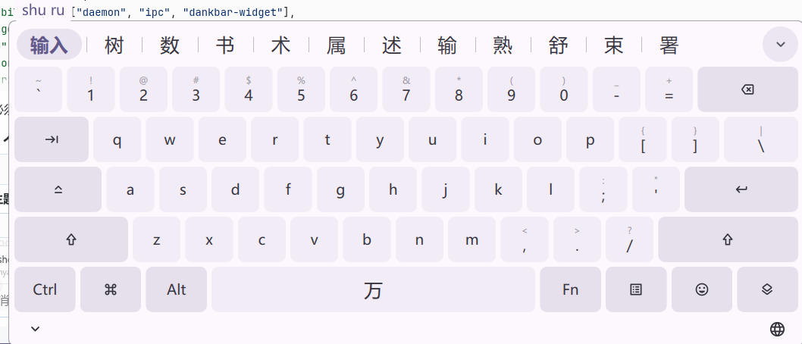
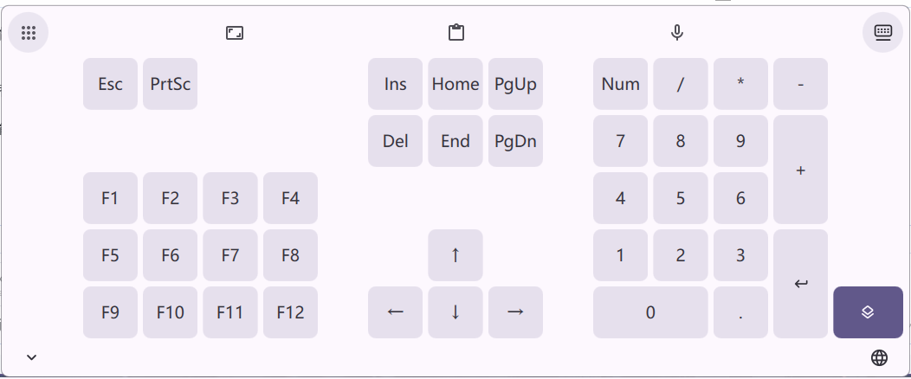
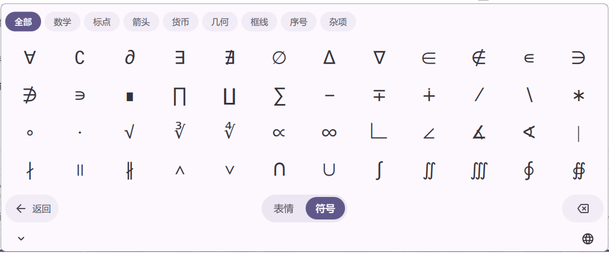

# Inline Keyboard — a touch keyboard for DankMaterialShell

**English** · [简体中文](README.zh-CN.md)



A DMS plugin: on-screen keyboard laid out like a phone IME (Gboard-ish), with
**fcitx5 as the input backend**. Candidates, the pinyin preedit and the current
input method come from a small purpose-built fcitx5 addon over a Unix socket and
are drawn inside the keyboard, so Chinese input no longer needs a separate popup
window.

> Status: feature-complete and in daily use on two devices (a desktop and a
> Xiaomi Pad 5 running Arch Linux ARM). Everything below works end to end:
> key injection through `ydotool`, fcitx5 candidates drawn inside the keyboard,
> candidate list page, two key pages + Fn layer, action grid with
> drag-to-reorder, docked and floating modes with position dragging, opacity
> panel, resize panel, emoji/symbol page, minimise-to-bubble, voice mode,
> per-locale strings.
>
> See [Verified in practice](#verified-in-practice) for what was actually
> exercised on hardware, and [AI assistance](#ai-assistance) for how this was
> built.

## Features

**Typing**

- Phone-style layout: two key pages plus an Fn layer (F1–F12, numpad, arrows,
  editing keys)
- Candidates, preedit and input-method state are drawn **inside** the keyboard —
  no separate popup window; long preedit elides from the front
- Paged, scrollable candidate list; clipboard action; a globe key that cycles
  input methods and shows the current sub-mode label (万 / abc)
- Emoji page (~1900 emoji in 9 categories) and a symbols page (math, punctuation,
  arrows, currency, shapes, box drawing…)

**Layout and chrome**

- Docked (bottom, reserves screen space) or floating (drag anywhere)
- Drag the handle to move; drag an edge to resize — the size is remembered
- Opacity panel for the panel and for individual keys; key repeat interval
- Special-key labels as icon / short / full name; the Win key can use a custom icon
- Minimise to a small floating bubble (position remembered); voice mode collapses
  the keyboard to a single capsule
- Colours follow the active DMS theme

**Actions**

- Functions page with 11 built-in actions (undo, redo, settings, float, size,
  opacity, next input method, clipboard, avoid windows, voice, minimise) plus your
  own `sh -c` commands
- Drag to reorder; drag an action into the quick bar or the corner slot
- Four tap behaviours for Shift / Ctrl / Alt / Win

**Integration**

- IPC surface (`toggle`, `open`, `close`, `setMode`, `setPage`, …) and an optional
  DankBar widget
- English by default; `zh_CN` translation included

| Second key page (Fn layer) | Emoji and symbols |
|---|---|
|  |  |

## Design

Keys go out through **`ydotool`** — a real `uinput` device, so to the compositor it *is* a keyboard
and modifiers, Alt+Tab, Mod+number and `Print` behave natively. When the input method has an engine
and no Ctrl/Alt/Super is held, keys short-circuit straight into fcitx5 instead. Candidates, preedit
and input-method state come from a small purpose-built fcitx5 addon
([own repository](https://github.com/LilFishyChan/fcitx5-inline-keyboard-status)) over a Unix
socket — pushed, not polled.

```text
 key press ──ydotool──▶ compositor ──▶ focused app ──text-input──▶ fcitx5
                                                                     │
                                                        fcitx5 addon │
                                                     (inline-keyboard-status)
                                                                     │
 keyboard surface (QML)  ◀────────state / candidates─── Unix socket ──┘
                │
                └── key / select / commit ──▶ addon ──▶ fcitx5
```

Protocol tables, the window layer and the design decisions: `docs/ARCHITECTURE.md`.
Geometry and layout rules: `docs/layout.md`.

## Requirements

**Required**

- `ydotool` + a running `ydotoold`:
  ```sh
  systemctl --user enable --now ydotool    # ships with the ydotool package
  ```
  `ydotool` writes through `/dev/uinput`, i.e. it looks like a real keyboard to the
  compositor. That is why typing, modifiers and compositor shortcuts (Alt+Tab, Mod+number,
  `Print`) all behave natively — no virtual-keyboard protocol, no binding lookup.
- DMS ≥ 2.0 (`~/.config/dms/plugins/`; 1.6.x uses `~/.config/DankMaterialShell/plugins/`)

`StartupCheck.qml` only probes `ydotool` — that is the one thing without which the
keyboard cannot produce a single character. Everything below degrades instead of breaking.

**Strongly recommended** (keys, quick bar and settings still work without them — you
just get no candidates and no input-method switching)

- `fcitx5` with an active input method (pinyin/rime)
- The **`inline-keyboard-status` fcitx5 addon** — the keyboard only gets candidates and
  input-method state through it. Without the addon the candidate strip stays empty
  and the globe key cannot switch context:
  ```sh
  # the addon lives in its own repository — it is not cloned with the plugin
  git clone https://github.com/LilFishyChan/fcitx5-inline-keyboard-status /tmp/fcitx5-inline-keyboard-status
  cd /tmp/fcitx5-inline-keyboard-status && cmake -B build -G Ninja && ninja -C build
  cmake --install build --prefix ~/.local      # installs library + addon conf
  systemctl --user restart 'app-org.fcitx.Fcitx5@autostart.service'
  ```

**Optional**

- `vinput` — voice input. Without it the *Voice input* action and voice mode stay
  greyed out; the rest of the keyboard is unaffected.

Clipboard copies go through DMS's own `dms cl copy`, so no extra package is needed.

## Install

```sh
git clone https://github.com/LilFishyChan/dms-inline-keyboard ~/.config/dms/plugins/inlineKeyboard
systemctl --user restart dms       # first install needs a restart
dms ipc call plugins status inlineKeyboard
dms ipc call inlineKeyboard toggle
```

The clone directory name must equal the plugin id (`inlineKeyboard`).

## Layout of the source

| File | Responsibility |
|---|---|
| `plugin.json` | Manifest: id, permissions, dependencies, `startupCheck` |
| `StartupCheck.qml` | Probes the one hard dependency — `ydotool` — before enabling |
| `InlineKeyboardDaemon.qml` | Daemon: state, settings, IPC commands, host of both windows |
| `KeyboardWindow.qml` | Docked (layer-shell anchored) keyboard window |
| `FloatingKeyboardWindow.qml` | Floating keyboard window, draggable, clamped to screen |
| `KeyboardMetrics.qml` | **Single source** for card width / unit / key height / handle height |
| `KeyboardCard.qml` | Card shell: shared state, drag state machine, page switching, composition |
| `QuickBar.qml` | Top quick bar: nav button, quick actions, circular slot |
| `ActionList.qml` | Function action grid, edit mode, drag-to-reorder |
| `CandidateBar.qml` | Candidate strip — first item elided from the left, the rest from the right |
| `TransparencyPanel.qml`, `OpacitySliderRow.qml` | The two-slider opacity panel |
| `ImPicker.qml` | Input-method picker shown on long-press of the globe |
| `DragGhost.qml` | Follow-the-finger block while dragging an action |
| `BottomBar.qml` | Bottom handle row: collapse, input method, fcitx5 tray icon |
| `EmojiPanel.qml` | Emoji / symbol grid + the bottom row (back / emoji·symbols / backspace) |
| `EmojiCategoryBar.qml` | Category chips shown in the top bar on the emoji page |
| `Key.qml` | One key: two-line cap, Fn layer substitution, ripple |
| `ActionIcon.qml` | One action icon — shared by list / quick bar / slot / drag ghost |
| `Ripple.qml`, `Slider.qml` | Small widgets used by keys, buttons and the opacity panel |
| `InlineKeyboardWidget.qml` | Optional DankBar pill that toggles the same global "open" var |
| `actions.js` | **Pure** action-list logic (sanitize, move, filter, hit-test). Unit-tested |
| `layouts/phone.js` | Layout data: rows, units, key maps, function-key pages |
| `layouts/emoji.js` | **Generated**: emoji groups (Unicode 16) + symbol groups |
| `tools/gen-emoji.py` | Regenerates `layouts/emoji.js` from Unicode's `emoji-test.txt` |
| `scripts/` | Legacy helpers kept for the tray icon / input-method list fallbacks |
| `translations/` | Per-locale strings (`zh_CN.json`); source strings stay English |
| `icons/` | Hand-drawn SVG (the "floating" glyph) |
| `docs/` | Protocol notes and layout/geometry rules; Chinese versions are `*.zh-CN.md` |

## Development

```sh
node --test tests/        # pure logic: actions.js
qmlformat *.qml >/dev/null  # parse check; `qmllint` on Arch ships as a stub here
                            # (it exits 0 even on broken syntax — do not trust it)

# deploy to this machine and to the tablet, then restart DMS
rsync -a --exclude=.git --exclude=docs --exclude=tests ./ \
      ~/.config/dms/plugins/inlineKeyboard/
rm -rf ~/.cache/quickshell/qmlcache          # QML disk cache must be cleared
systemctl --user restart dms
dms ipc call plugins status inlineKeyboard         # expect: loaded
```

QML caches compiled components by path — after editing a `.qml` file, always
clear `~/.cache/quickshell/qmlcache`, or you will debug line numbers that no
longer exist. A change inside a nested component sometimes survives
`plugins reload`; a full `systemctl --user restart dms` is the reliable path.

### IPC

| Command | Effect |
|---|---|
| `dms ipc call inlineKeyboard open` / `close` / `toggle` | Show / hide / toggle the keyboard |
| `dms ipc call inlineKeyboard toggleFloat` | Switch docked ↔ floating |
| `dms ipc call inlineKeyboard setMode <keys\|functions\|transparency\|resize>` | Switch panel |
| `dms ipc call inlineKeyboard setPage <page1\|page2\|emoji>` | Switch key page |
| `dms ipc call inlineKeyboard resetActions` | Restore the default action set |

## Emoji & symbols

The mood key in the bottom row of the first key page opens the emoji page. It
lives inside the same card (same height, same top/bottom bars), switched by
`page: "emoji"` rather than by `mode`.

- **Top bar** — category chips: `All` plus the nine Unicode groups on the emoji
  side, and eight symbol groups (math, punctuation, arrows, currency, shapes,
  box drawing, numbers, misc) on the symbol side. The bar scrolls sideways when
  it does not fit.
- **Middle** — a scrolling grid, four rows high, the column count follows the
  card width.
- **Bottom row** — `Back`, the `Emoji | Symbols` segment switch, and backspace
  (hold to repeat).

Insertion does **not** go through the key-injection path. `EmojiPanel` only
reports the character; the daemon hands it to the fcitx5 addon, which calls
`InputContext::commitString()` in-process. A ZWJ emoji (`👨‍👩‍👧`) is several code
points and cannot be expressed as keycodes, so this is the only path that
works. Without the addon the character is copied to the clipboard instead, via
DMS's own `dms cl copy`.

`layouts/emoji.js` is **generated**: `python3 tools/gen-emoji.py` reads
Unicode 16's `emoji-test.txt` (cached under `tools/.cache/`) and writes 1900
emoji — skin-tone variants are deliberately left out — plus the symbol tables.
The generated file is committed, so users never need Python at runtime.

## Edit mode

Touch the pencil at the bottom of the actions page to enter edit mode. The quick
bar and the action list then show **what will be there after you let go**, not
the current state:

| Where you drop | What you see while dragging | What you get |
|---|---|---|
| Between two quick‑bar items | The item takes that slot; the rest shift aside | Inserted at that index |
| Left / right of the quick‑bar edge | Same, at index 0 / last | Inserted at the edge |
| Quick bar is full | The last item becomes a ghost at the **top of the list** | Last item is ejected into the list |
| The round slot | The slot shows the dragged icon | Dragged action takes the slot, the old one returns to the list |
| Back onto the list | The list opens a gap at the drop point | Moved out of the quick bar |

The quick‑bar drop slot is computed from the ghost's centre
(`Actions.quickBarInsertIndex`), and the resulting arrays come from
`Actions.planQuickBarDrop` — the same function the actual drop uses, so the
preview cannot disagree with the result. Capacity is
`min(6, floor((midW + gap) / (slotW + gap)))`, i.e. it follows the keyboard
width; a full bar ejects its **last** item to make room.

Ghosts (the inserted item in the quick bar, the ejected item in the list) are
drawn at 55 % opacity with a 2 px `primary` outline. The dragged item itself
stays fully opaque over the quick bar — the ghost is the preview, so dimming
both would leave nothing to read.

Quick‑bar items are capsules, the bar's edit background is a capsule of
`surfaceContainerLow`, and the `primary` frame follows the items: no items, no
frame; the frame spans from one gap left of the first item to one gap right of
the last.

## Modifier behaviour

`Shift` / `Ctrl` / `Alt` / `Win` carry one of three states: `0` off,
`1` active but the next normal key clears it, `2` locked (only tapping the key
again clears it). How a touch moves between them is a plugin setting
(`modifierMode`):

| Setting | Touch | A normal key press |
|---|---|---|
| `noLock` — active while held | press → `1`, release → `0`; a tap leaves nothing behind | — |
| `toggle` — tap to activate | tap `0` ⇄ `1` | clears it |
| `tapLock` — tap to lock | tap `0` ⇄ `2` | keeps the lock |
| `doubleTapLock` (default) | tap → `1`; same key again within 300 ms → `2`; tap `2` → `0` | clears state `1`, keeps state `2` |

So `doubleTapLock` is exactly "single tap = `toggle`, double tap = `tapLock`".
`Caps Lock` ignores the setting — it is always a plain toggle and normal keys
never clear it. Press and release are only wired up for `noLock`; the other
modes act on the tap. Switching the mode resets all modifier states.

## Colours

Everything comes from DMS's dynamic theme (`Theme.*`); there is no hard-coded
colour in the plugin. Surfaces follow the M3 surface ladder, so a light/dark
switch or a wallpaper change carries over on its own:

| Part | Token |
|---|---|
| Card background | `Theme.surface` — same value as the settings page |
| Key face (normal) | `Theme.surfaceContainer` |
| Key face (modifier: Tab / Ctrl / Shift…) | `Theme.surfaceContainerHighest` |
| Key face (Fn layer) | `Theme.primary` @ 0.16 |
| Key face (active, unlocked) | fill unchanged; 2 px `primary` outline + `primary` label |
| Key face (locked modifier, current page) | `Theme.primary` solid, glyphs `Theme.onPrimary` |
| Key labels / icons | `Theme.surfaceText` (= `onSurface`) |
| Upper symbol row | `Theme.onSurfaceVariant` |
| Action tile (default / active) | `Theme.surfaceContainer` / `Theme.primary` solid + `onPrimary` |
| Round bar buttons | `Theme.surfaceContainerHigh` |
| Ripple, drag ghost, drop preview | `Theme.primary` @ 0.06–0.92 |
| Card & picker outline | `Theme.outlineVariant` @ 0.7 |

Keys and action tiles carry **no border** in their normal state.
`Theme.primaryContainer` is not used for the active state: DMS runs its container
colours through an elevation tint, so on a light theme it comes out `#ffd2d4` —
practically the same as the key face (`#ffd1dd`). So the three levels are told apart by
**fill vs outline vs solid** — `surfaceContainer` fill → `primary` 2 px outline → `primary` solid —
which survives both themes, unlike an alpha stack.


## Translations

Source strings are English and go through `I18n.trFor("inlineKeyboard", …)`
(`tr()` helpers in the card, the settings page and the startup check).
Translations live in `translations/<locale>.json`:

```json
{ "Inline Keyboard": { "Appearance": "外观" } }
```

Translations are registered by `PluginService` **asynchronously, after the plugin
QML is constructed**, and only on `I18n.onLocaleApplied` (i.e. at DMS start):

- Restart the shell after adding/editing a translation —
  `dms ipc call plugins reload` does not pick it up.
- A plain `I18n.trFor(...)` call inside a binding is evaluated once, against a
  still-empty table, and then stays English forever. `tr()` in `KeyboardCard.qml`
  and `InlineKeyboardSettings.qml` therefore reads a `localeVersion` property that a
  short timer flips as soon as the table contains `inlineKeyboard`; that property is
  what makes the bindings recompute. (`Connections { target: I18n; function
  onPluginTranslationsChanged() … }` does not fire inside the plugin — poll.)
- `trFor`'s first argument is the **plugin id** (`inlineKeyboard`), not the display
  name. Reading an undeclared property (`root.pluginId` on a component without
  it) yields `undefined`, which silently degrades every string to English with no
  error in the journal — the failure mode looks exactly like "translation not
  loaded".

## Verified in practice

Not "written and assumed to work" — the items below were exercised on real
hardware (desktop + Xiaomi Pad 5 with a touchscreen), with either unit tests or
IPC/diagnostic output backing the claim:

| Area | How it was verified |
|---|---|
| Pure logic (action list, drag plans, modifier state machine, candidate slicing, resize arithmetic, special-key tables) | `node --test tests/` — **188 assertions** |
| Addon protocol (state push, bulk candidate list, key/select/commit) | round-tripped against a live fcitx5; journal shows one line per state change |
| Key injection | real typing into applications through `ydotool`, on both devices |
| Candidates + preedit drawn in-keyboard | live rime 万象 input, candidate list opened/closed/scrolled |
| Input-method switching (globe key, long-press picker) | tapped on the tablet; the label on the space bar follows every tap |
| Docked / floating switch, position dragging, resize panel, opacity panel | used on the tablet; geometry confirmed from IPC values, not screenshots |
| Emoji / symbol insertion | tapped on hardware; falls back to `dms cl copy` without the addon |
| Translations (zh_CN) | strings switched at runtime and compared on screen |

Regressions found this way are listed as commits against the source, not as
claims in this README.

## AI assistance

This plugin was **built with substantial AI assistance** — pair-programmed
through Hermes Agent (an AI coding agent) together with the author, who drove
the design decisions, tested every build on real devices, and rejected plenty
of wrong turns along the way.

Being explicit about that, because it matters for anyone evaluating the code:

- **Every claim in "Verified in practice" was actually executed.** The test suite
  runs; the addon round-trips against a live fcitx5; the keyboard was typed on
  in real applications on two machines. Nothing here rests on "the code looks
  right".
- **AI-written code is reviewed like any other code.** Naming, duplication,
  comment accuracy and error handling follow the repository's own standards;
  the unit tests and a real QML parse (`qmlformat`) gate every change.
- **Known weak spot, stated openly:** the QML surface layer (layout, gesture
  feel, visual alignment) is the part AI is worst at. Those pieces were tuned
  through many iterations against real touch input, and the diagnostic IPC
  commands under `### IPC` exist partly because that loop is where bugs kept
  hiding. Expect the pure-logic modules to be the most dependable and the
  gesture/animation polish to be the most "hand-tuned".
- **No AI-generated code was merged without running it.** If you find something
  that contradicts the table above, that is a bug — please open an issue.

## Roadmap

1. Splitting `KeyboardCard.qml` (~1400 lines / 130 properties) into smaller
   components — the resize panel and candidate panel are the obvious first cuts
2. Long-press alternate characters on the letter keys
3. Optional: space commits the first candidate while a candidate list is open
4. More layouts beyond the current phone-style pages

## License

GPL-3.0-only.

## How typing works

Every key event goes through one path:

```
Key.qml (label/modifier state)  →  KeyboardCard.keyPressed  →  InlineKeyboardDaemon.handleKey
   ├─ stub / page   →  handled locally (toast / page switch)
   ├─ modifier key  →  cycleModifier() (0 / one-shot / locked)
   └─ anything else →  injectKey(code)
                          ↓  shape: [modifier presses] code:1 code:0 [modifier releases]
                       `ydotool key 42:1 30:1 30:0 42:0`     ← shift + a = "A"
```

`ydotoold` is a hard dependency: if its socket (`$XDG_RUNTIME_DIR/.ydotool_socket`)
is missing, injection returns early and the settings page shows a warning with a
**Start** button. `KeyboardCard` never talks to the compositor directly — it only
renders state and reports key presses.

Shift is folded into the modifier sequence (not into the character), which is why
`Shift+A` really produces `A` and `Shift+1` produces `!` — the keymap does that, not us.
